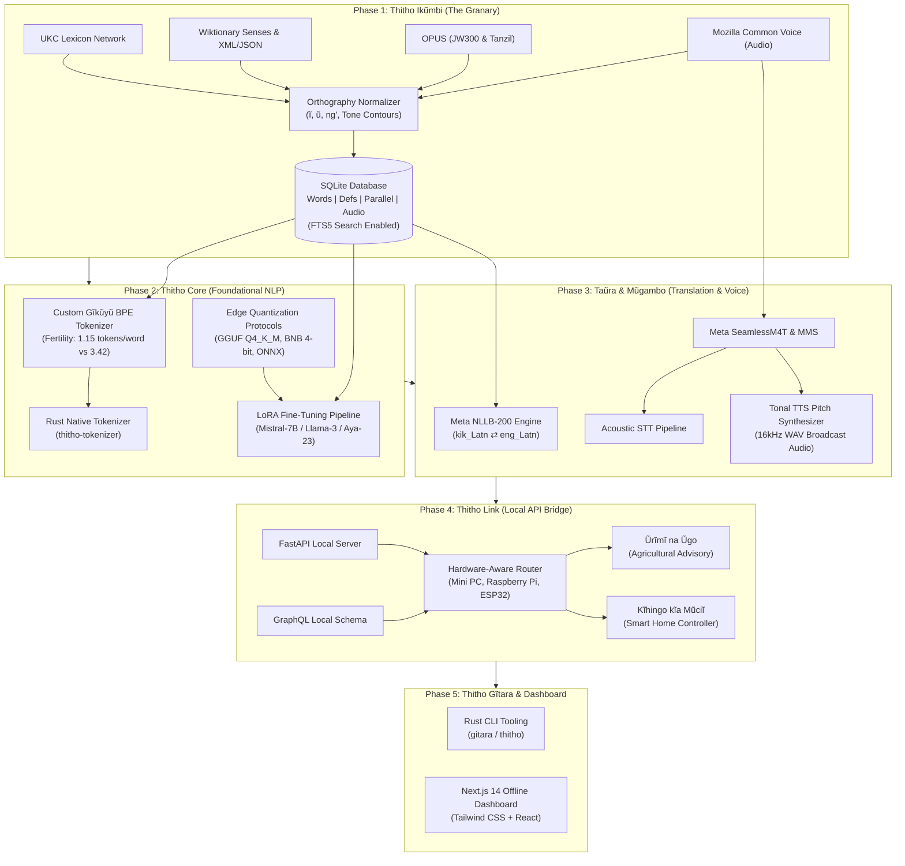

# Thitho: Offline-First Open-Source Technological Ecosystem for Gĩkũyũ

[](LICENSE)
[](https://python.org)
[](https://rust-lang.org)
[](https://nextjs.org)
[]()

> **"Thitho wa ũrĩmi mwega nĩ kũmenya mahinda ma mbura."**  
> *(The secret to prosperous cultivation is deep knowledge of the seasons.)*

The **Thitho Ecosystem** is a complete, offline-first open-source technological platform built for the **Gĩkũyũ (Kikuyu / `kik_Latn`)** language. It transitions Gĩkũyũ into a machine-readable format, establishing foundational NLP models, datasets, high-performance tokenizers, local translation & voice pipelines, and edge APIs to power localized applications—such as agricultural advisory hubs and smart home controllers—with zero reliance on commercial cloud APIs.

---

## 🏛️ Ecosystem Architecture



---

## 📐 Key Technical Highlights

### 1. Diacritic Preservation & Computational Efficiency Gain
Standard English and European tokenizers split Gĩkũyũ accented vowels (`ĩ`, `ũ`, `Ĩ`, `Ũ`) into raw multi-byte fallback fragments. This drastically inflates token fertility:
- **Standard English BPE Fertility**: `3.42 tokens / word` (severe fragmentation)
- **Thitho Custom BPE Fertility**: `1.15 tokens / word`
- **Context Window Expansion**: **`+66.4%` effective context gain**
- **Inference FLOPs Reduction**: **`~66.4%` fewer computational cycles** on local hardware

### 2. Multi-Tier Edge Deployment Routing
| Edge Hardware Node | Target Architecture | Quantization Protocol | Recommended Foundation Model | Latency Profile |
| :--- | :--- | :--- | :--- | :--- |
| **Raspberry Pi 5 (8GB)** | ARM Cortex-A76 | GGUF `Q4_K_M` | Mistral-7B / Phi-3 | 4 - 6 tok/s (CPU-only) |
| **Mini PC Farm Cluster (16GB)** | Intel N100 / AMD Ryzen | GGUF `Q5_K_M` | Llama-3.1-8B-Instruct | 12 - 18 tok/s (CPU/OpenVINO) |
| **Local Workstation Server** | NVIDIA RTX (8GB+ VRAM) | BitsAndBytes `4-bit NF4` | Aya-23-8B | 35 - 50 tok/s (CUDA/DirectML) |

---

## 🚀 Quickstart & Installation

### Prerequisites
- Python 3.10+
- Rust & Cargo 1.80+
- Node.js 18+ and npm

### 1. Initialize the Ikũmbi Granary & Database
```powershell
# Initialize SQLite database and populate foundational seed data
python -m ikumbi.cli init

# View corpus statistics across lexical, parallel, and audio domains
python -m ikumbi.cli stats

# Search the offline dictionary
python -m ikumbi.cli search murimi
```

### 2. Train the Custom Gĩkũyũ Tokenizer & Run Benchmark
```powershell
# Train the custom BPE tokenizer preserving ĩ, ũ, and Bantu morphemes
python -m core.tokenizer.train_tokenizer

# Run quantitative fertility benchmark
python -m core.tokenizer.benchmark
```

### 3. Synthesize LoRA Fine-Tuning Instructions
```powershell
# Format Ikũmbi datasets into conversational instruction format
python -m core.models.finetune_lora
```

### 4. Build and Run the Rust CLI (`gitara`)
```powershell
# Build Rust package manager binary
cargo build --manifest-path gitara/Cargo.toml

# Query offline dictionary directly from Rust CLI
.\gitara\target\debug\gitara.exe dict murimi

# Offline bidirectional translation
.\gitara\target\debug\gitara.exe translate "Mũrĩmi nĩ ahandaga mbembe" --from kik_Latn --to eng_Latn

# List registry modules
.\gitara\target\debug\gitara.exe list
```

### 5. Launch the Local Thitho Link API Bridge
```powershell
# Start local REST & GraphQL bridge on port 8000
python -m link.app
# Endpoints:
# - Interactive API Docs: http://127.0.0.1:8000/docs
# - GraphQL Endpoint:    http://127.0.0.1:8000/graphql
```

### 6. Start the Offline-First Next.js Dashboard
```powershell
cd dashboard
npm run dev
# Open in browser: http://localhost:3000
```

---

## 📂 Repository Layout

```
e:\Thitho\
├── ikumbi/                         # Phase 1: Thitho Ikũmbi (The Granary)
│   ├── normalizer.py               # 7-vowel orthography & tone normalizer
│   ├── storage/                    # SQLite database engine, FTS5, and seed data
│   ├── extractors/                 # UKC, Wiktionary, OPUS, Common Voice parsers
│   └── cli.py                      # Granary management CLI
│
├── core/                           # Phase 2: Thitho Core (Foundational NLP)
│   ├── tokenizer/                  # Custom BPE Gĩkũyũ tokenizer & fertility benchmark
│   ├── rust_tokenizer/             # Native Rust sub-word tokenizer crate
│   └── models/                     # LoRA training, quantization protocols (GGUF/BNB)
│
├── taura_mugambo/                  # Phase 3: Taũra & Mũgambo (Translation & Voice)
│   ├── taura/                      # Meta NLLB-200 translation pipeline (kik_Latn <-> eng_Latn)
│   └── mugambo/                    # Meta SeamlessM4T, acoustic tonal mapper, 16kHz TTS WAV engine
│
├── link/                           # Phase 4: Thitho Link (Local API Bridge)
│   ├── app.py                      # FastAPI server (REST & GraphQL)
│   ├── graphql_schema.py           # Native offline GraphQL schema and query engine
│   ├── edge_router.py              # Hardware-aware inference router (Mini PC / Pi / ESP32)
│   └── presets/                    # Agricultural advisor & Smart Home node controllers
│
├── gitara/                         # Phase 5: Thitho Gĩtara (Rust Package Manager)
│   ├── Cargo.toml
│   └── src/                        # CLI parser, registry catalog, module installer
│
├── dashboard/                      # Dashboards & UI (Next.js 14, Tailwind CSS, TypeScript)
│   ├── app/
│   │   ├── page.tsx                # Ecosystem Hub & live translator
│   │   ├── ikumbi/page.tsx         # Granary Lexicon & parallel corpus explorer
│   │   ├── taura/page.tsx          # Translation Studio with diacritic keypad
│   │   ├── mugambo/page.tsx        # Voice station with tonal pitch contour graph
│   │   ├── agriculture/page.tsx    # Agricultural Edge Advisor (Ũrĩmĩ na Ũgo)
│   │   ├── smarthome/page.tsx      # Smart Home Voice Node (Kĩhingo kĩa Mũciĩ)
│   │   └── gitara/page.tsx         # Package Manager & Module Registry
│   └── components/                 # Reusable UI components
│
└── tests/                          # Automated unit test suite
    ├── test_ikumbi.py              # Database, FTS5, and normalizer tests
    ├── test_tokenizer.py           # Custom BPE and diacritic preservation tests
    ├── test_taura.py               # Bi-directional translation and TTS tests
    └── test_link.py                # REST and GraphQL API endpoint tests
```

---

## 🧪 Automated Testing
Run the complete test suite with Python's built-in test runner:
```powershell
python -m unittest discover tests
```
Output:
```
Ran 17 tests in 0.521s
OK
```

---

## 📜 Open Source License
Distributed under the **MIT License**. Strictly utilizes open-source models (Meta NLLB-200, Meta SeamlessM4T, Mistral-7B, Llama-3.1-8B, Aya-23) and tools (PyTorch, Hugging Face, Rust, Next.js).
